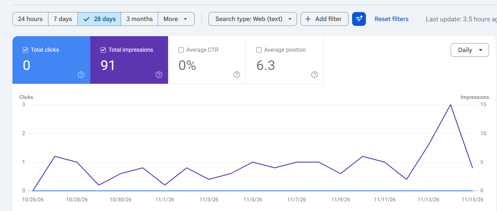

# Google Search Console baseline — 17 November 2026

Saved on **2026-11-17**, Asia/Karachi, from the owner's supplied Search Console screenshot. This records the displayed values; it is not an API export.

Site context: **asghar.me**. The property selector is outside the screenshot crop, so the exact property identifier is not independently confirmed here.

## Baseline metrics

| Metric | Displayed value |
| --- | ---: |
| Total clicks | 0 |
| Total impressions | 91 |
| Average CTR | 0% |
| Average position | 6.3 |

## Report settings and date limits

| Setting | Screenshot evidence |
| --- | --- |
| Selected date preset | 28 days |
| Search type | Web (text) |
| Chart grouping | Daily |
| Visible x-axis labels | 2026-10-26 through 2026-11-15 |
| Additional filters | No active filter chips visible in this crop |
| Data freshness label | “Last update: 3.5 hours ago” |

**The exact start and end dates of the selected 28-day period are not shown.** Axis labels do not establish the full reporting window. Do not treat the visible tick dates as the exact range or infer a capture time from the relative freshness label.

Queries, landing pages, country/device breakdowns, indexing status, and Google-selected canonicals were not included. The 6.3 position is an aggregate report value, not a claim that the site ranks sixth for a particular keyword.

## Deployment context

The portfolio SEO and homepage redesign were deployed on **2026-11-17**, through [PR #2](https://github.com/aasghar110/asghar.me/pull/2), production merge commit `e04f93014448c58bcc7ead7ad51e8bfe91df7f5f`.

This screenshot is the initial comparison reference around deployment. It does **not** establish an improvement caused by the release; its visible chart dates precede deployment.

## Future comparison

- First weekly review: **2026-11-24**. Treat it as an early signal; rolling 28-day reports will overlap substantially.
- First 28-day post-release review: **2026-12-15**. Use the same verified property, search type, filters, and an equal-length comparison window. Record the actual dates displayed in Search Console and whether the latest days are incomplete.
- Save each new snapshot beside this file as `YYYY-MM-DD.md`, with its source screenshot or export. Preserve this baseline.
- Record clicks, impressions, CTR, average position, and absolute changes. A click growth percentage from this baseline is undefined because baseline clicks are zero. Record position as a numeric change, remembering that a lower position number is better.
- Include top queries/pages and indexing information when available. Do not attribute changes to the redesign alone without checking query mix, recrawl timing, and other changes.

| Snapshot date | Actual reporting dates | Clicks | Impressions | CTR | Avg. position | Notes |
| --- | --- | ---: | ---: | ---: | ---: | --- |
| 2026-11-17 | Exact dates not visible; 28-day preset | 0 | 91 | 0% | 6.3 | Initial supplied screenshot |

## Source screenshot

Remaining Search Console tasks are tracked in [issue #1](https://github.com/aasghar110/asghar.me/issues/1).
